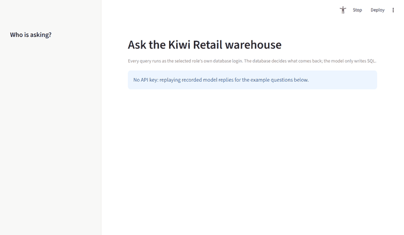
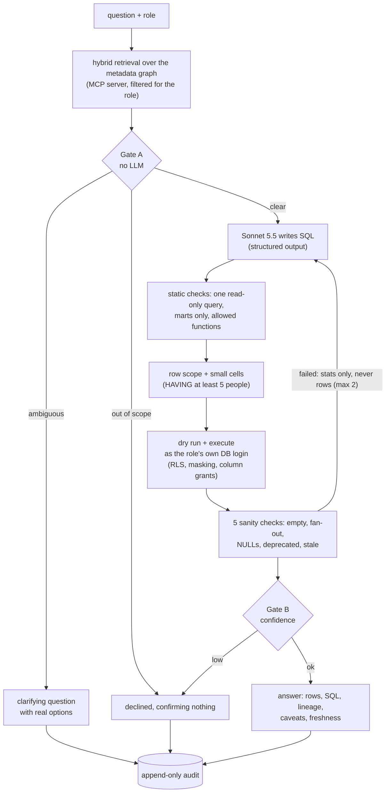

# warehouse-qa

**Ask a data warehouse questions in plain English, without the AI being able to leak anything.**

Each question runs as the asking user's own database login. The model only writes SQL: the database decides which rows and columns come back, every query is checked before and after it runs, and the assistant asks or declines when it should. It finds its way around with a metadata graph (dbt models, lineage, metrics, known caveats) rather than text chunks.



One of two linked projects built on [`warehouse-graph`](https://github.com/Crestward/warehouse-graph). The other is [`pipeline-sentinel`](https://github.com/Crestward/pipeline-sentinel).

## Results, on a held-out test set
90 questions, run once from a frozen commit, with the comparisons written down first. Full tables, confidence intervals and every failure: [`docs/results.md`](docs/results.md).

| | Whole schema in the prompt | Vector search | **This system** | Perfect retrieval |
|---|---|---|---|---|
| Correct results (73 answerable) | **94.5%** | 78.1% | 86.3% | 90.4% |
| Planted traps avoided (24) | 83.3% | 58.3% | 79.2% | 91.7% |
| Right behaviour: answer, ask or decline (90) | 92.2% | 87.8% | 93.3% | 93.3% |
| Wrong, of the questions it answered | 12.7% | 14.9% | 10.0% | 9.6% |
| Leaks | 0 | 0 | 0 | 0 |
| Input tokens per question | 4,133 | 3,971 | 3,000 | 1,223 |

**Security:** 0 leaks in 50 red-team attacks, 0 of 10 prompt injections obeyed, and 0 leaks in 1,100 attempts with a model *scripted to obey the attacker*. With two controls switched off, the same attacks do leak, so the test can see. ([`docs/threat-model.md`](docs/threat-model.md))

**The honest headline:**
- **The naive baseline wins on accuracy here** (94.5% vs 86.3%, p = 0.03; 95.9% vs 89.0%, p = 0.125 if other valid readings of four ambiguous questions count, see [label review](docs/label-review.md)). With only 20 tables, the whole schema fits in the prompt, and retrieval sometimes drops a table the model needed: 5 of the 10 wrong answers.
- **Graph-aware retrieval beats vector search** (8 wins, 2 losses), and verification adds stale-data warnings and trap catches. Neither is statistically significant at this size.
- **What holds up is the governance:** no leak in any configuration, refusals that confirm nothing, and no group of fewer than 5 people ever shown.
- **If I were shipping this for a warehouse this small,** I'd keep the governance, checks and gates, and feed the model the role-filtered schema directly.

## Try it (no API key needed)
Needs [Docker](https://docs.docker.com/get-docker/), [uv](https://docs.astral.sh/uv/) and git.

```bash
git clone https://github.com/Crestward/warehouse-qa
cd warehouse-qa
make demo            # or: uv run python scripts/demo.py
```
This clones `warehouse-graph` next to it, starts Postgres, builds the synthetic warehouse (40 dbt models), the graph and the access policies, then opens http://localhost:8501. The example questions replay recorded model replies; retrieval, gates, checks and the database are live. To ask anything (about US$0.01 a question), put `ANTHROPIC_API_KEY` in `warehouse-graph/.env`.

```bash
uv run warehouse-qa ask --role analyst_nz "How much net revenue did each region make in the first half of 2025?"
```

## How it works



- **The LLM is never the enforcement point.** One `policies.yml` compiles to database roles, row-level security, column grants and masking views, and the same file filters what the model can *see*.
- **Rows never reach the model.** Repairs get counts, null rates and numeric ranges.
- **Refusals are fixed text.** A hidden column, a column that never existed and a blocked query read the same.
- **Trust nothing in the docs.** Descriptions are delimited data; three prompt injections are planted in the demo's dbt docs.

## How it's measured
- **150 labelled questions** (90 regular, 40 planted traps, 20 that should be clarified or declined) across five roles. Gold SQL runs *as the question's role*. Frozen, hashed 60/90 dev/test split.
- **50 red-team prompts** in five categories, plus the compromised-model test and its positive control.
- **Deterministic scoring**, no LLM judge. Bootstrap CIs and exact McNemar tests.
- **Batch API, response cache, offline calibration:** the whole project has cost **US$3.10** in model calls.
- **CI:** lint, types, unit tests, and an integration job that builds the warehouse. A 20-question real-model gate runs only on PRs labelled `eval`.

## Docs
| | |
|---|---|
| [Results](docs/results.md) | test tables, plot, every failure explained |
| [Design decisions](docs/design-decisions.md) | Q1–Q7, negative results included |
| [Label review](docs/label-review.md) | which labels are questionable, and how much they matter |
| [Evaluation protocol](docs/eval.md) | labelling, metrics, splits, what was frozen |
| [Threat model](docs/threat-model.md) | controls, red team, residual risks |
| [Gates](docs/gates.md), [retrieval tuning](docs/retrieval-tuning.md), [contamination](docs/contamination.md) | generated reports |

## Development
```bash
make check                 # lint, format, types, tests
make eval-check            # gold queries as their roles, labels, contamination (no LLM)
make redteam               # the 50 attacks (fails on any leak)
uv run warehouse-qa eval run --config configs/config4.yaml --split dev     # about US$0.25
uv run warehouse-qa eval results                                           # regenerate docs/results.md
```

## Limits and next steps
v1 is evaluated on one synthetic warehouse, by its author; see the limits in [`docs/results.md`](docs/results.md#limits-of-this-evaluation). Deliberately left out of v1 ([parking lot](https://github.com/Crestward/warehouse-graph/blob/main/docs/parking-lot.md)):
- the role-filtered schema as a retrieval fallback for small warehouses, and finding the size at which retrieval starts to win
- public benchmarks (Spider 2.0-Lite, BIRD): they have no dbt manifest, so they need a schema-introspection graph
- agreement between several generations, for the errors no check can see
- observed lineage from Unity Catalog

**Prior art:** dbt Labs' official [`dbt-mcp`](https://github.com/dbt-labs/dbt-mcp) serves lineage and the semantic layer. This project differs in caveat and trap nodes, metadata filtered by the same policy the database enforces, and the evaluation.

## Licence
MIT. See [LICENSE](LICENSE).
