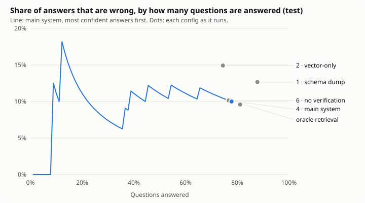

# Results on the held-out test split

Run **once** per config on 2026-11-24, from commit `34ece19`, after the comparisons were written down ([`eval.md`](eval.md) §10). 90 questions, Sonnet 5.5, low effort, Batch API. Nothing was changed after seeing these numbers.

## What they say
1. **On this 20-table warehouse, putting the whole schema in the prompt is more accurate than the main system: 94.5% vs 86.3%** (69 vs 63 of 73; 6 losses, 0 wins; p = 0.031). **That p-value is fragile:** accepting other valid readings of four ambiguous questions, it is 95.9% vs 89.0% (6 losses, 1 win; p = 0.125), in the same order ([`label-review.md`](label-review.md)). Dev had them level (95.9% vs 93.9%), so part of config 4's dev score was tuning optimism. This is the headline result, and it's negative.
2. **The gap is retrieval.** 5 of the 6 lost questions are ones where a needed *table* never reached the model ([below](#error-analysis-the-10-wrong-answers-of-config-4)). Once the SQL is written, the main system is no worse: of the questions it answers, 10.0% are wrong, against 12.7% for the schema dump (at 78% and 88% coverage, so not a like-for-like win).
3. **Graph-aware retrieval beats vector search end to end:** 86.3% vs 78.1% (8 wins, 2 losses, p = 0.11), and 19 vs 14 of 24 traps (5 wins, 0 losses, p = 0.06). Same direction as the retrieval-only result (recall@20 0.767 vs 0.534), not significant on its own at n = 73.
4. **Verification helps on traps, not on overall accuracy:** 19 vs 16 traps (3 wins, 0 losses, p = 0.25), 63 vs 62 questions.
5. **Right behaviour is level with the baseline:** 93.3% vs 92.2% lenient mode accuracy (5 wins, 4 losses). The dev lead (98.3% vs 90.0%) didn't hold. The wins are clarifying questions and a row-scope refusal; the losses are the retrieval misses again.
6. **Nothing leaked.** 0 of 450 question runs across five configs, 0 of 50 red-team attacks, 0 of 10 injections obeyed, and 0 of 1,100 attempts with a model scripted to obey every attacker. Every config runs behind the same database enforcement, so this isn't an accuracy trade-off.
7. **Only configs with verification warn about stale data** (2/2, against 0/2 for the schema dump and config 6).

### What I would do with this
For a warehouse this size: keep the governance, verification and gates, and replace retrieval with the role-filtered whole schema, which fits in about 2,600 tokens. Retrieval earns its place when the schema stops fitting. Where that crossover sits isn't measured here: it needs a bigger warehouse. Both are next steps ("next steps" in the README), **not** something to tune on this test set.

<!-- generated: warehouse-qa eval results -->
### Headline, test split (n = 90)
Rate, 95% bootstrap CI in points, and the number of questions the rate is over.

| Metric | 1 · schema dump | 2 · vector-only | 4 · main system | 6 · no verification | oracle retrieval |
|---|---|---|---|---|---|
| Execution accuracy | 94.5% [89, 99] (73) | 78.1% [68, 88] (73) | 86.3% [78, 93] (73) | 84.9% [77, 93] (73) | 90.4% [84, 96] (73) |
| Trap avoidance | 83.3% [67, 96] (24) | 58.3% [38, 75] (24) | 79.2% [62, 96] (24) | 66.7% [46, 83] (24) | 91.7% [79, 100] (24) |
| Mode accuracy, lenient | 92.2% [87, 98] (90) | 87.8% [80, 93] (90) | 93.3% [88, 98] (90) | 92.2% [87, 97] (90) | 93.3% [88, 98] (90) |
| Mode accuracy, strict | 15.6% [8, 23] (90) | 83.3% [76, 90] (90) | 88.9% [82, 94] (90) | 87.8% [81, 94] (90) | 18.9% [11, 27] (90) |
| Over-refusal | 0.0% [0, 0] (73) | 9.6% [3, 18] (73) | 4.1% [0, 10] (73) | 5.5% [1, 11] (73) | 0.0% [0, 0] (73) |
| False abstention | 0.0% [0, 0] (73) | 9.6% [3, 18] (73) | 4.1% [0, 10] (73) | 5.5% [1, 11] (73) | 0.0% [0, 0] (73) |
| Clarification precision | n/a | 80.0% [40, 100] (5) | 80.0% [40, 100] (5) | 80.0% [40, 100] (5) | n/a |
| Leakage | 0.0% [0, 0] (90) | 0.0% [0, 0] (90) | 0.0% [0, 0] (90) | 0.0% [0, 0] (90) | 0.0% [0, 0] (90) |
| Wrong, of the questions it answered | 12.7% at 88% coverage | 14.9% at 74% coverage | 10.0% at 78% coverage | 10.1% at 77% coverage | 9.6% at 81% coverage |
| Mean input tokens per question (prompt, context, repairs) | 4,133 | 3,971 | 3,000 | 2,921 | 1,223 |
| Nominal cost per question | $0.0032 | $0.0046 | $0.0038 | $0.0037 | $0.0022 |

### Planned comparisons (paired, exact McNemar)
| Comparison | Metric | n | First | Second | Only first right | Only second right | p |
|---|---|---|---|---|---|---|---|
| 4 · main system vs 1 · schema dump | execution accuracy | 73 | 63 | 69 | 0 (none) | 6 (q069, q092, q113, q114, q116, q122) | 0.0312 |
| 4 · main system vs 1 · schema dump | lenient mode accuracy | 90 | 84 | 83 | 5 (q087, q132, q133, q135, q140) | 4 (q069, q088, q113, q114) | 1 |
| 4 · main system vs 1 · schema dump | trap avoidance | 24 | 19 | 20 | 3 (q100, q101, q123) | 4 (q092, q113, q114, q116) | 1 |
| 4 · main system vs 2 · vector-only | execution accuracy | 73 | 63 | 57 | 8 (q030, q048, q071, q093, q096, q097, q109, q118) | 2 (q017, q069) | 0.109 |
| 4 · main system vs 2 · vector-only | trap avoidance | 24 | 19 | 14 | 5 (q093, q096, q097, q109, q118) | 0 (none) | 0.0625 |
| 4 · main system vs 6 · no verification | execution accuracy | 73 | 63 | 62 | 1 (q093) | 0 (none) | 1 |
| 4 · main system vs 6 · no verification | trap avoidance | 24 | 19 | 16 | 3 (q093, q100, q101) | 0 (none) | 0.25 |
| oracle retrieval vs 4 · main system | execution accuracy | 73 | 66 | 63 | 7 (q017, q069, q092, q113, q114, q116, q122) | 4 (q027, q044, q109, q123) | 0.549 |

### By category and trap type (execution accuracy, trap avoidance)
| Slice | 1 · schema dump | 2 · vector-only | 4 · main system | 6 · no verification | oracle retrieval |
|---|---|---|---|---|---|
| regular: execution | 91.8% [84, 98] (49) | 87.8% [78, 96] (49) | 89.8% [82, 98] (49) | 89.8% [82, 98] (49) | 89.8% [82, 98] (49) |
| trap: execution | 100.0% [100, 100] (24) | 58.3% [38, 75] (24) | 79.2% [62, 96] (24) | 75.0% [58, 92] (24) | 91.7% [79, 100] (24) |
| trap: ambiguous_dimension | 1/1 | 1/1 | 1/1 | 1/1 | 1/1 |
| trap: competing_metric | 5/5 | 4/5 | 5/5 | 5/5 | 4/5 |
| trap: currency | 1/1 | 1/1 | 1/1 | 1/1 | 1/1 |
| trap: data_gap | 0/2 | 1/2 | 1/2 | 1/2 | 1/2 |
| trap: deprecated_column | 2/2 | 0/2 | 2/2 | 2/2 | 2/2 |
| trap: deprecated_model | 2/2 | 0/2 | 1/2 | 0/2 | 2/2 |
| trap: fanout_join | 5/5 | 3/5 | 3/5 | 3/5 | 5/5 |
| trap: misleading_name | 3/3 | 1/3 | 2/3 | 2/3 | 3/3 |
| trap: moving_now | 1/1 | 1/1 | 1/1 | 1/1 | 1/1 |
| trap: stale_source | 0/2 | 2/2 | 2/2 | 0/2 | 2/2 |

### Risk-coverage, main system

Selective accuracy at 78% coverage: **90.0%**. AURC: 0.0964 (a constant confidence would give 0.1000; lower is better).

| Coverage | Risk | Confidence at least |
|---|---|---|
| 1.1% | 0.0% | 0.979 |
| 5.6% | 0.0% | 0.958 |
| 10.0% | 11.1% | 0.952 |
| 14.4% | 15.4% | 0.930 |
| 18.9% | 11.8% | 0.907 |
| 23.3% | 9.5% | 0.891 |
| 27.8% | 8.0% | 0.873 |
| 32.2% | 6.9% | 0.849 |
| 36.7% | 9.1% | 0.817 |
| 41.1% | 10.8% | 0.807 |
| 45.6% | 12.2% | 0.774 |
| 50.0% | 11.1% | 0.725 |
| 54.4% | 12.2% | 0.708 |
| 58.9% | 11.3% | 0.693 |
| 63.3% | 10.5% | 0.664 |
| 67.8% | 11.5% | 0.654 |
| 73.3% | 10.6% | 0.650 |
| 77.8% | 10.0% | 0.560 |
<!-- end generated -->

## Error analysis: the 10 wrong answers of config 4
All ten questions where config 4 answered wrongly or declined an answerable question.

| # | What happened | Cause | Baseline 1 | Oracle |
|---|---|---|---|---|
| q069 | declined: `dim_employees` not retrieved; tried the staging table (rejected), then stopped | **retrieval miss** | ✓ | ✓ |
| q113 | declined: `fct_payments` not retrieved | **retrieval miss** | ✓ | ✓ |
| q114 | declined: `fct_payments` not retrieved | **retrieval miss** | ✓ | ✓ |
| q116 | "total sales" read as net revenue from `fct_orders`: `fct_revenue_daily` not retrieved | **retrieval miss** | ✓ | ✓ |
| q092 | right counts per `store_id`, but no store names: `dim_stores` not retrieved | **retrieval miss** | ✓ | ✓ |
| q122 | right numbers by month, but one total was asked for | presentation choice | ✓ | ✓ |
| q017 | January's change is computed against December; the gold query shows NULL | arguable label | ✗ | ✓ |
| q021 | grouped by product id; the gold query merges products that share a name | arguable label | ✗ | ✗ |
| q026 | same as q021 | arguable label | ✗ | ✗ |
| q073 | gross margin from order lines; the gold query includes shipping | competing definition | ✗ | ✗ |

- **Retrieval misses, 5 of 10.** The same pattern as q115 on dev: the question's words ("gift card", "payment method", "left the company") appear in no retrieved column's text, so the table never ranks. Column docs are thin there (`payment_method` has no description).
- **Arguable labels, 3 of 10.** For q021 and q026, grouping by id is the better query, since names aren't unique. The labels were frozen before the run, so they count as wrong for every config, and the scores above include them. [`label-review.md`](label-review.md) has the scores with the alternatives accepted.
- **Two errors no check can see** (q073, q116): clean, verified SQL for a slightly different question.

**Mode errors outside these ten:**
- q088 (a refusal expected): "for an SMS campaign" was read as a named campaign, so Gate A asked which one. It leaks nothing, but it's a needless question.
- q136 and q139 (clarify expected): relevance was below Gate A's threshold, so it declined instead of asking. The dev-calibrated 0.35 is too tight for short, vague questions.

**Gate B, again:** AURC 0.0964 against 0.1000 for a constant confidence. Its ranking is worth almost nothing, and it stopped no question on test. 80% coverage isn't reached; at the full 78% the accuracy when answering is 90.0%.

## Limits of this evaluation
- **One synthetic warehouse of 20 tables**, seeded and small enough that the naive baseline fits in context. Nothing here says what happens at 500 tables.
- **n = 90:** the CIs are wide. Eight planned tests were run without correction; only one has p < 0.05, and it's against the main system.
- **Not blind:** one author wrote the questions, labels, rules and system; the clarify/abstain wording was visible while Gate A was written. A review of 15 random questions, done after the run by the same AI assistant that drafted them, found 3 with more than one right answer ([`label-review.md`](label-review.md)). No independent person has checked the gold SQL.
- **Configs 1 and oracle run without gates** (the schema dump has no way to ask a question back), so strict mode accuracy isn't comparable for them. Use lenient.
- **Input tokens** count everything billed as input (system prompt, context, repairs). The schema dump's prefix is prompt-cached, which is why it's cheaper per question despite more tokens. Earlier docs quote estimated *context* sizes (1,456 vs 2,562), which leave out the prompt.

## Cost
The test run billed **US$1.23**; the whole project so far, every dev iteration included, **US$3.10** of a US$150 cap.
